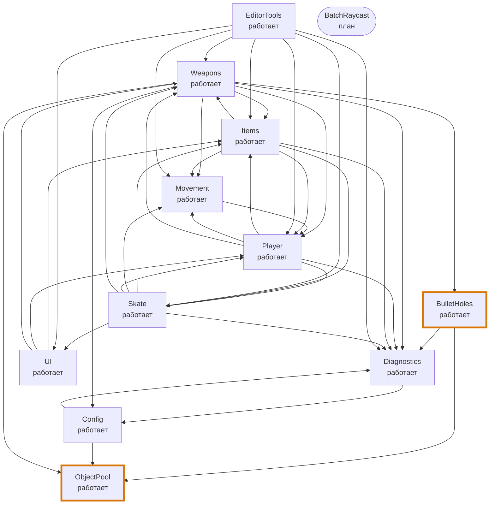

# Модульная карта BeerAndDragon

Источник — [`modules.json`](modules.json); этот файл и `module-map.png` генерирует `python tools/pz02/render_map.py`.
Соответствие карты коду проверяет `python ci/check_module_map.py` (и CI, `_checks.yml`).

**Легенда.** `A --> B` — исходный код A зависит от контракта или типов B (ссылается на них в коде). Направление вызова может отличаться: `Weapons` вызывает реализацию пула, но зависит только от `IObjectPool` и фабрики. Двойная стрелка — цикл (объяснён ниже). Статус: «работает» — код есть и вызывается; «план» — модуля ещё нет. Жирная рамка — модули ПЗ-2.

## Модули

| Модуль | Ответственность | Контракт | Зависит от | Где | Статус | Автор записи |
|---|---|---|---|---|---|---|
| **ObjectPool** | Выдача и переиспользование объектов с жёстким лимитом; правило переиспользования самого старого | IObjectPool<T>: Get / Release / Prewarm / IsActive, счётчики; ошибки — docs/modules/object-pool.md | — | `Assets/Game/Scripts/Core/` | работает | EgorSad06 |
| **BulletHoles** | Постановка дырок от пуль на поверхность и снятие по истечении времени; прогон -decalProbe | BulletHoles(IObjectPool<GameObject>, offset, lifetime, flip): Place(point, normal, spin, now), Tick(now) | ObjectPool, Diagnostics | `Assets/Game/Scripts/GunScript/BulletHoles.cs` | работает | EgorSad06 |
| **Config** | Чтение и проверка game-config.json (targetFps, logLevel, decalPool) | GameConfig.TryParse(json) -> Values | ошибка; Load(args); Apply() | Diagnostics, ObjectPool | `Assets/Game/Scripts/Diagnostics/GameConfig.cs` | работает | EgorSad06 |
| **Diagnostics** | Журнал, версия сборки, запуск/завершение с кодом, smoke-прогон для CI | GameLog.Info/Warn/Error/Verbose, Quit(code); BuildInfo.Full; -version, -ciSmoke N | Config | `Assets/Game/Scripts/Diagnostics/` | работает | EgorSad06 |
| **Weapons** | Стрельба, меч, переключение оружия; точка сборки пула декалей | Weapon: магазин, перезарядка, AddAmmo; WeaponSwitcher.Equip(name); Damageable | BulletHoles, ObjectPool, Config, Diagnostics, Items, Movement, Player | `Assets/Game/Scripts/GunScript/` | работает | EgorSad06 |
| **Movement** | Передвижение рыцаря, камера, бег по стенам | KnightMovement, CameraPOV (Yaw, AddRecoil), WallClimb, WallRunSurface | Player | `Assets/Game/Scripts/MainKnight/` | работает | EgorSad06 |
| **Player** | Здоровье, эффекты, блокировка ввода, анимация рыцаря, вид от 3-го лица | PlayerHealth.TakeDamage/Heal, PlayerStatusEffects, PlayerInputLock, KnightAnimator | Diagnostics, Items, Movement, Skate, Weapons | `Assets/Game/Scripts/Player/` | работает | EgorSad06 |
| **Items** | Инвентарь (стопки, обмен), подбор, использование предметов | Inventory.Add/Swap/Use/CompleteUse; ItemDefinition; ItemUser | Diagnostics, Movement, Player, Skate, Weapons | `Assets/Game/Scripts/Items/` | работает | EgorSad06 |
| **Skate** | Катание, трюки, грайнд, очки, звуки | SkaterController (состояния, события TrickAdded/ComboLanded), GrindRail, Skateboard | Diagnostics, Items, Movement, Player, UI, Weapons | `Assets/Game/Scripts/Skate/` | работает | EgorSad06 |
| **UI** | HUD: здоровье, спидометр, патроны, сумка-инвентарь | GameHUD (строится из кода), InventorySlotView, UISprites | Items, Player, Weapons | `Assets/Game/Scripts/UI/` | работает | EgorSad06 |
| **EditorTools** | Инструменты редактора: сборка в двух режимах, генерация ассетов, настройка сцены (в игру не входят) | BuildTool.BuildDevelopment/BuildRelease; меню Tools > BeerAndDragon | Diagnostics, Items, Movement, Player, Skate, UI, Weapons | `Assets/Game/Scripts/Editor/` | работает | EgorSad06 |
| **BatchRaycast** | Пакетные лучи дроби через Job System (направление B, SP-2) | будет определён в ПЗ по параллелизму | — | `—` | план | EgorSad06 |

## Циклические зависимости

Циклы — в игровом коде, где компоненты одного игрока обращаются друг к другу напрямую. Модули ПЗ-2 (`ObjectPool`, `BulletHoles`) в циклах не участвуют: `ObjectPool` не зависит ни от чего, `BulletHoles` — только от `ObjectPool` и `Diagnostics`.

| Модули | Почему |
|---|---|
| Config ↔ Diagnostics | GameLog при старте загружает конфигурацию (GameConfig.Load), а GameConfig пишет в журнал и берёт аргументы через GameLog. Оба — инфраструктура старта; разорвать можно выносом разбора аргументов в отдельный CommandLine. |
| Movement ↔ Player | Передвижение читает PlayerInputLock (лежит в Player), а KnightAnimator и ThirdPersonCamera читают состояние передвижения. Исторически блокировка ввода живёт в Player; план — вынести её в общий модуль ввода. |
| Items ↔ Player | Предметы применяют эффекты к PlayerHealth/PlayerStatusEffects, а KnightAnimator проигрывает позы ItemUser (курение, питьё). |
| Items ↔ Weapons | Inventory выбирает оружие через WeaponSwitcher, а WeaponSwitcher проверяет наличие Inventory (FindFirstObjectByType) для выбора оружия по умолчанию. |
| Items ↔ Skate | ItemUser не даёт пить/курить на скейте (SkaterController), а SkaterController не даёт встать на доску при открытой сумке (Inventory). |
| Player ↔ Skate | KnightAnimator ставит ноги по доске (SkaterController), а SkaterController наносит урон при падении (PlayerHealth) и учитывает ускорение (PlayerStatusEffects). |
| Player ↔ Weapons | KnightAnimator анимирует руки по состоянию Sword/Weapon, а оружие проверяет PlayerInputLock. |
